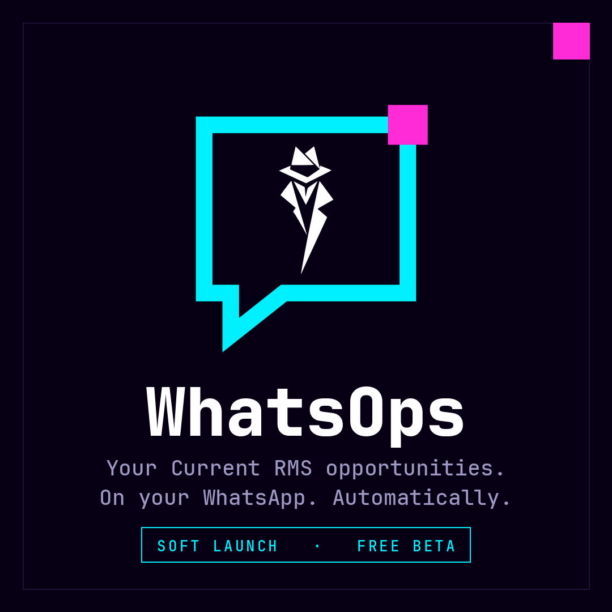
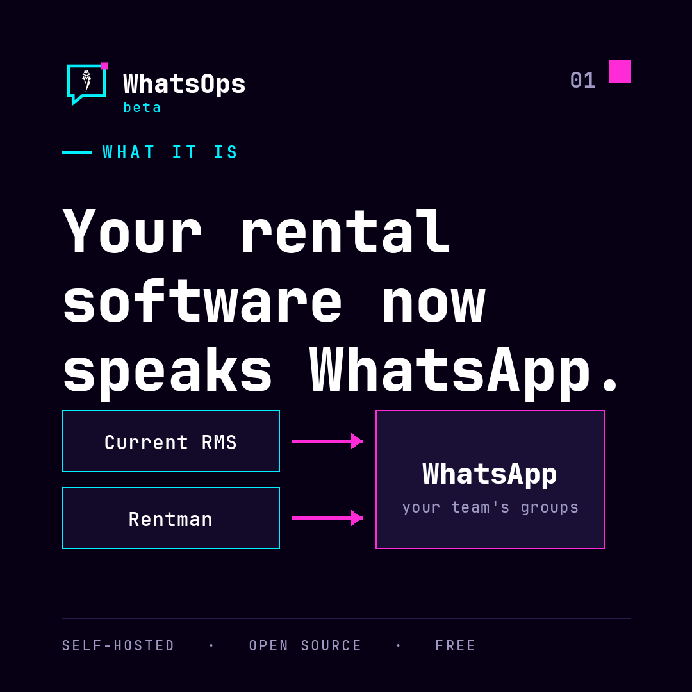
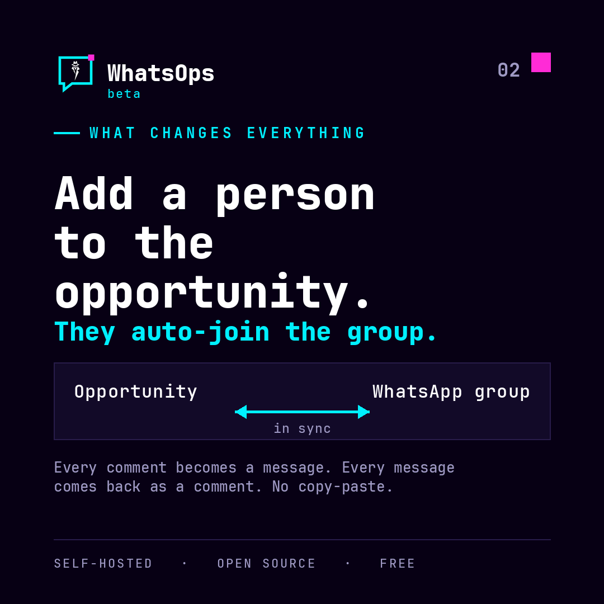
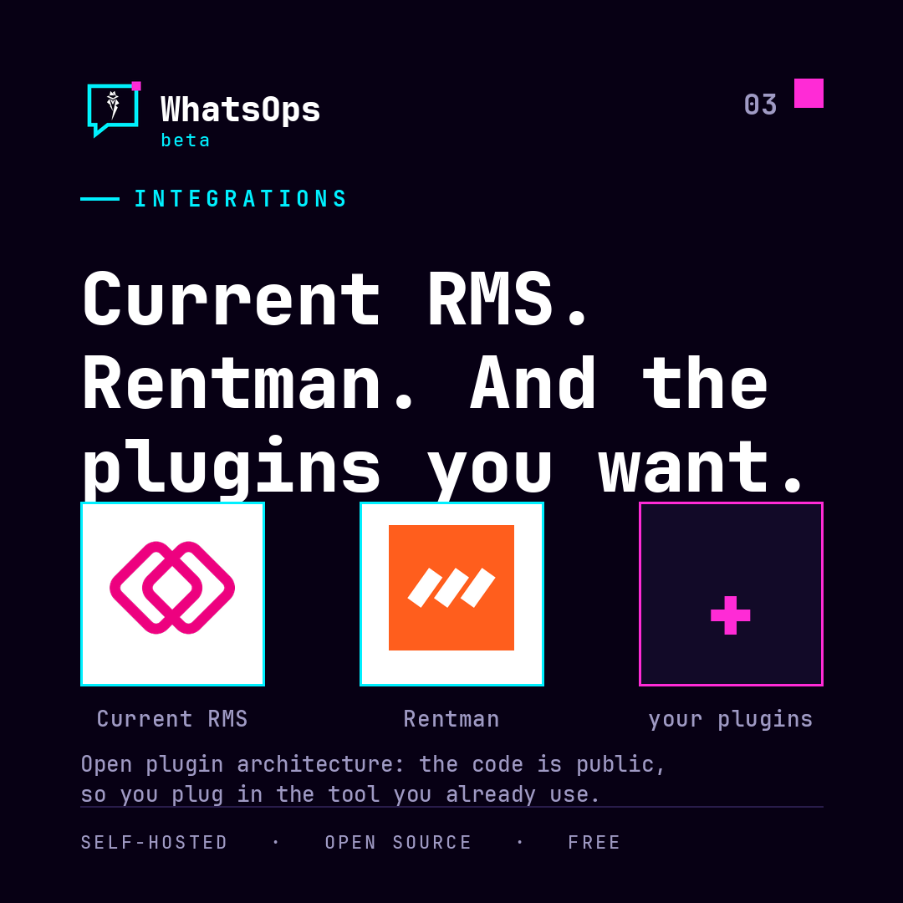
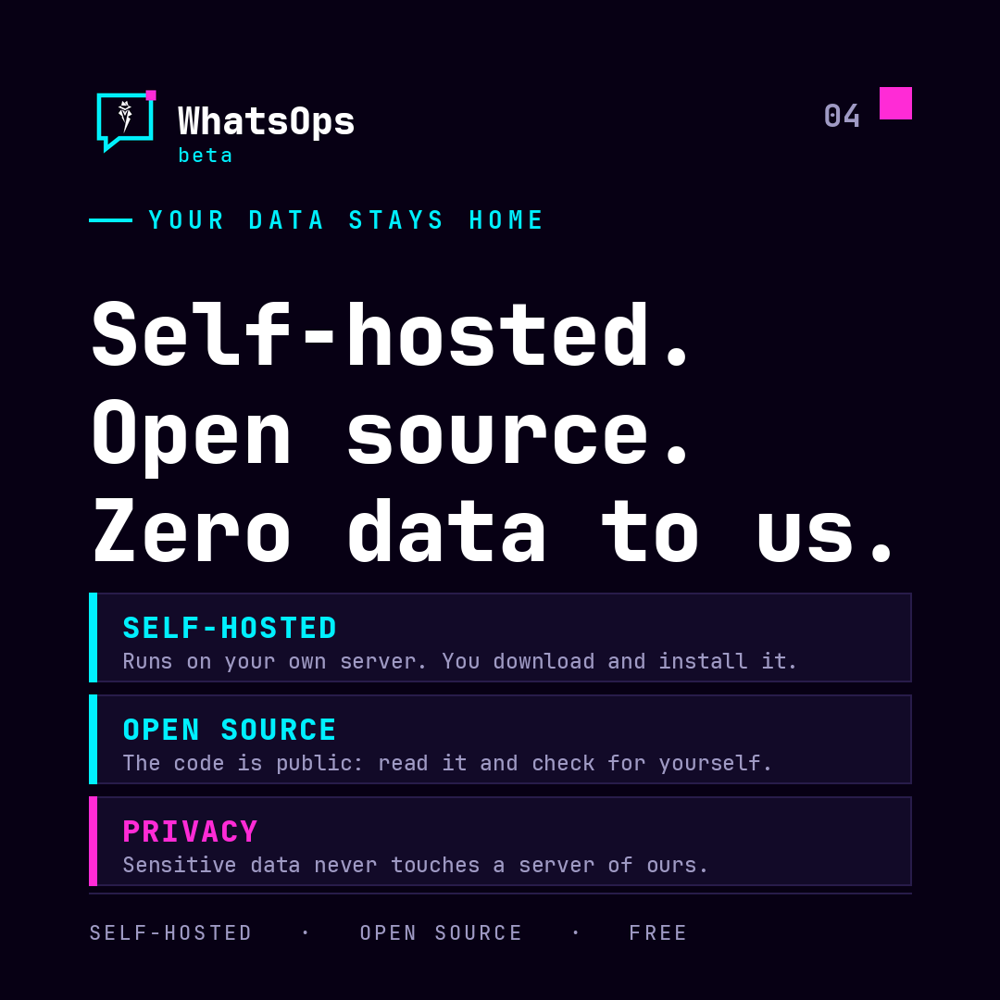

<p align="center">
  
</p>

<p align="center">
  <b>Your Current RMS &amp; Rentman opportunities, right on your team's WhatsApp — automatically.</b><br>
  Add someone to an opportunity and they join its WhatsApp group on their own.<br>
  Two-way, in sync, no copy-paste. &nbsp;Open source · self-hosted · free.
</p>

<p align="center">
  
  
  
  
</p>

<h3 align="center">⬇&nbsp;&nbsp;Download</h3>

<p align="center">
  <a href="https://github.com/emrgim/WhatsOps/releases/latest"></a>
  &nbsp;
  <a href="https://github.com/emrgim/WhatsOps/releases/latest"></a>
  &nbsp;
  <a href="https://github.com/emrgim/WhatsOps/releases/latest"></a>
</p>

<p align="center">
  <sub>Node.js is bundled — nothing else to install. WhatsOps keeps running in the background and updates itself.<br>
  Exact files and checksums for every system (Intel / ARM, <code>.deb</code> / <code>.rpm</code>): <a href="#install">all installers ↓</a></sub>
</p>

---

## What it does

<table>
  <tr>
    <td width="50%"></td>
    <td width="50%"></td>
  </tr>
  <tr>
    <td width="50%"></td>
    <td width="50%"></td>
  </tr>
</table>

> **Beta — and that's the point.** WhatsOps is a free, open beta (versions `0.0.x`; the config page shows the exact build, e.g. `0.0.1 beta (build 45113d9)` = the git commit it was built from). Install it, try it, and tell us what works and what doesn't from **Settings → Feedback** — one click, no GitHub account needed.

WhatsApp **REST API + MCP server** for your own numbers, built on [Baileys](https://baileys.wiki) v7 (WhatsApp Web linked device).

One process holds one linked-device connection per number and exposes it three ways:

- **MCP** (`/mcp`, Streamable HTTP) for AI agents: Claude, ChatGPT, Grok, Gemini, Cursor, Hermes… with OAuth 2.1 or API keys, plus a stdio proxy for stdio-only clients.
- **REST API** (`/v1`) with OpenAPI docs at `/docs`, Server-Sent Events and signed webhooks.
- **Config page** (`/`) to link numbers (QR code or phone-number pairing code) and edit their WhatsApp profile, connect plugins and MCP clients, create API keys, manage webhooks, choose the database and the appearance (Light / Dark / System), read the service log, send feedback and get updates.

English and Italian: the config page follows the browser language, the server (MCP tool texts, errors) follows the operating system language.

## Features

- Several WhatsApp numbers in one server, each with its own session; a default number for calls that do not name one.
- Chats, messages, contacts and groups stored in SQL: **SQLite** by default, **PostgreSQL** or **MySQL/MariaDB** selectable from the config page (with optional copy of all data and automatic restart).
- Full history import when a number is linked (optional), media download, search.
- Send text, media (URL or base64), location, reactions; edit / delete own messages; mark as read. Idempotency keys, per-number rate limit, per-chat pause, optional recipient allow-list.
- OAuth 2.1 (PKCE, dynamic client registration, static client ids) with 24 h access tokens and 90-day sliding refresh tokens; scoped API keys (`read`, `send`, `admin`) limited to chosen numbers.
- Admin sign-in with a one-time code sent to the number's own "Message yourself" chat, a one-time login link, or a password.
- Each number's id is its **phone number** and its name is its **WhatsApp profile name**, kept live. Name, info and photo can be edited from the config page, the API or MCP: the change is made on WhatsApp itself, so the two never differ.
- **Feedback** (Settings → Feedback, or the `whatsops_feedback` MCP tool) opens an issue in this repository without any GitHub login: every installation signs with its own installation code (`WO-XXXX-XXXX`).
- **Crash and malfunction reports**: crashes and errors are kept (scrubbed of numbers, names, keys and paths) and sent only if you choose: ask first (default), send automatically, or don't collect. The same problem becomes one issue.
- **Auto-update**: a `git clone` installation checks this repository's releases every 5 minutes, installs a new version by itself (fetch, `npm ci`, build, restart) and goes back to the previous one if the new one does not start. Installations with local changes are never touched.
- **Plugins** (Connectors → Plugins): **Current RMS** and **Rentman** — see below.
- **Users with granular permissions** (Settings → Users). Besides the owner, users sign in with a code sent to their own WhatsApp number and see only what is enabled for them: by default nothing. Today a user can be given plugins; inside each plugin, its own permissions (Current RMS: only the records they own, or all; Rentman: only the projects they created, or all; manage the plugin or not). Users never get numbers, messages, API keys, MCP or settings, and cannot authorize MCP clients.
- **Voice messages → text** (Settings → Voice): agents cannot hear, so WhatsOps transcribes voice notes with [faster-whisper](https://github.com/SYSTRAN/faster-whisper) on the server — free, nothing leaves the server, on Linux, macOS and Windows. **Install faster-whisper** is one click: WhatsOps downloads it into its own folder with its own Python ([uv](https://github.com/astral-sh/uv)), no Python or commands needed, then the model you choose. An online service (xAI, OpenAI, Groq or any OpenAI-compatible one) or any command also work. Transcribe all voice notes as they arrive, or only on request; transcripts are stored once and show up in `whatsapp_get_messages`, in search and in the webhook event `message.transcribed`.
- **Backup** (Settings → Backup): one file with everything (numbers and their WhatsApp sessions, messages, contacts, settings, plugins, keys). Download it, or save it into a folder of the server you choose — by hand or every hour, day or week, keeping the last N. Optional password (AES-256-GCM). Restore from an uploaded file or from one in the folder: a copy of the current data is saved first, then WhatsOps restarts with the restored numbers.
- **Web app**: WhatsOps installs as an app (its own window and icon) from Chrome / Edge / Chromium, on iPhone and Android (Add to Home Screen) and as an **Omarchy web app** — see *Install as an app* below.
- Service log in **Settings → Log**, terminal style (`tail -f`): live, searchable, filterable by level, downloadable; every API change and MCP tool call is listed (never message bodies). Also kept as a rotating file in `<data>/logs/`.

## MCP tools

`whatsapp_accounts`, `whatsapp_get_profile`, `whatsapp_update_profile`, `whatsops_feedback`, `currentrms_discussions`, `currentrms_set_sync`, `currentrms_users`, `currentrms_user_invite`, `currentrms_record_group`, `rentman_projects`, `rentman_project_group`, `whatsapp_transcribe_voice`, `whatsapp_list_chats`, `whatsapp_get_messages`, `whatsapp_search_messages`, `whatsapp_find_contact`, `whatsapp_check_number`, `whatsapp_list_groups`, `whatsapp_get_group`, `whatsapp_send_text`, `whatsapp_send_media`, `whatsapp_send_location`, `whatsapp_react`, `whatsapp_mark_read`, `whatsapp_edit_message`, `whatsapp_delete_message`, `whatsapp_download_media`.

## Install

Download the installer for your system from the [latest release](https://github.com/emrgim/WhatsOps/releases/latest). Node.js is included: nothing else to install. Every installer sets WhatsOps up for your user, keeps it running in the background (it starts again at login and after a crash) and opens **http://127.0.0.1:8810** already signed in. New versions install by themselves (Settings → Updates).

| System | Installer | Install |
|---|---|---|
| macOS Intel | `WhatsOps-<version>-macos-x64.dmg` | Open it, drag **WhatsOps** to **Applications**, open WhatsOps. |
| macOS Apple Silicon (M1–M4) | `WhatsOps-<version>-macos-arm64.dmg` | Same. |
| Windows 10/11 (x64) | `WhatsOps-<version>-windows-x64-setup.exe` | Run it: no administrator rights needed. WhatsOps goes in the Start menu. |
| Debian, Ubuntu, Mint… (x64, arm64) | `WhatsOps-<version>-linux-<x64\|arm64>.deb` | `sudo apt install ./WhatsOps-<version>-linux-x64.deb`, then open WhatsOps from the applications menu. |
| Fedora, openSUSE… (x64, arm64) | `WhatsOps-<version>-linux-<x64\|arm64>.rpm` | `sudo dnf install ./WhatsOps-<version>-linux-x64.rpm`, then open WhatsOps from the applications menu. |
| Any Linux (no root) | script | `curl -fsSL https://raw.githubusercontent.com/emrgim/WhatsOps/main/install/linux.sh \| bash` |
| Omarchy | script | `curl -fsSL https://raw.githubusercontent.com/emrgim/WhatsOps/main/install/omarchy.sh \| bash` — opens as an Omarchy web app. |

Which Mac? Apple menu → About This Mac: *Chip Apple M…* → arm64, *Processor Intel* → x64. The `whatsops-…-runtime-….tar.gz` files in a release are not installers: WhatsOps downloads them when it updates itself.

The installers are not signed with paid Apple / Microsoft certificates, so the first time:
- **macOS**: if it says it cannot check the app, right-click WhatsOps → **Open** → **Open** (macOS 15 and later: System Settings → Privacy & Security → **Open Anyway**). Once.
- **Windows**: if SmartScreen says *Windows protected your PC*, click **More info** → **Run anyway**. Once.

Then go to **Numbers → Add number** and link the phone with the QR code or with a pairing code (WhatsApp → Linked devices → Link with phone number).

Where things are:

| | macOS | Windows | Linux |
|---|---|---|---|
| Data (database, sessions, media, logs) | `~/Library/Application Support/mcp-mrg-whatsops` | `%LOCALAPPDATA%\mcp-mrg-whatsops` | `~/.local/share/mcp-mrg-whatsops` |
| Background service | LaunchAgent `im.mrg.whatsops` | sign-in entry `WhatsOps` (HKCU Run) | systemd user unit `whatsops.service` |

Uninstall:
- **macOS**: `launchctl bootout gui/$(id -u)/im.mrg.whatsops; rm ~/Library/LaunchAgents/im.mrg.whatsops.plist`, then move WhatsOps to the Trash (delete the data folder too to remove everything).
- **Windows**: Settings → Apps → WhatsOps → Uninstall. It stops WhatsOps and asks whether to delete your data.
- **Linux**: `whatsops --uninstall` (packages) or `curl -fsSL https://raw.githubusercontent.com/emrgim/WhatsOps/main/install/linux.sh | bash -s -- --uninstall`; add `--purge` to delete the data. Then `sudo apt remove whatsops` / `sudo dnf remove whatsops` if you used a package.

The installers are built by GitHub Actions for every release ([`.github/workflows/packages.yml`](.github/workflows/packages.yml), [`packaging/build.mjs`](packaging/build.mjs)). Before a release gets them, each one is installed on its own system (macOS Intel and Apple Silicon, Windows, Ubuntu x64 and arm64), started, killed — it must come back by itself — and uninstalled.

### From source (git)

Requirements: **Node.js 24+** and git.

```bash
git clone https://github.com/emrgim/WhatsOps.git
cd WhatsOps
npm ci
npm run build
npm start                      # listens on http://127.0.0.1:8810
```

First sign-in (no number is linked yet, so no WhatsApp code can be sent):

```bash
node dist/cli.js login-link    # prints a one-time admin URL, valid 30 minutes
```

Open it, go to **Numbers → Add number**, and link the phone with the QR code or with a pairing code (WhatsApp → Linked devices → Link with phone number).

Run it as a service: `deploy/mcp-mrg-whatsops.service` is a systemd user unit (adjust the paths, see the comments inside). Auto-update restarts the service by itself, so keep a service manager with automatic restart (systemd `Restart=always`, launchd `KeepAlive`).

### Install as an app

The config page is a web app (manifest + icons), so it can live in its own window:
- **Chrome, Edge, Chromium**: the install icon at the right of the address bar (or menu → *Cast, save and share → Install page as app*).
- **Omarchy**: menu → *Install → Web App* (name `WhatsOps`, the address of your WhatsOps, icon `<address>/whatsops.png`), or in a terminal:
  ```bash
  omarchy-webapp-install "WhatsOps" "https://whatsops.example.com" "https://whatsops.example.com/whatsops.png"
  ```
  The Omarchy install script above already creates it for the WhatsOps on the same computer. The window bar follows the WhatsOps appearance (and the Omarchy theme with *System*).
- **iPhone / Android**: Share → *Add to Home Screen*.

### Voice messages

Settings → General → **Voice messages**, pick the engine:

| Engine | What it needs | Where the audio goes |
|---|---|---|
| **On this computer** | `pip install faster-whisper` (Python 3.9+); the model (`small` ≈ 500 MB) downloads the first time | nowhere |
| **Online service** | API key of xAI (`grok-voice-transcribe-2.0`), OpenAI (`gpt-4o-mini-transcribe`), Groq (`whisper-large-v3-turbo`) or any OpenAI-compatible service (`/audio/transcriptions`) | to that service |
| **Command** | any program that prints the text: `{file}` is the audio file (`.ogg`), `{lang}` the language or `auto` | wherever the program sends it |

Agents then read voice messages like text: `whatsapp_get_messages` gives each voice note its `seconds` and `transcript` (null until transcribed), `whatsapp_transcribe_voice` transcribes one on request (stored, so asking again is instant), `whatsapp_download_media` adds the transcript for audio (and the audio itself with `include_audio`), `whatsapp_search_messages` also finds words said in voice notes. API: `POST /v1/messages/{id}/transcribe`. With *Transcribe new voice messages as they arrive* on, every new voice note is transcribed by itself and webhooks receive `message.transcribed` with the text in `data.transcript` and `context`.

### Expose it

WhatsOps listens on loopback only. Put it behind a reverse proxy or tunnel (Caddy, nginx, Cloudflare Tunnel…) with HTTPS and set the public URL (`WA_PUBLIC_URL` or Settings → General). OAuth and the MCP connectors need the public HTTPS URL.

## Connect

The config page, **Connectors**, lists plugins and MCP clients as tiles (Cursor, Claude, ChatGPT, Grok, Grok Bot, Hermes, Gemini, any other MCP client); open a tile for its ready-to-paste settings.

- **OAuth clients** (Claude, ChatGPT, Gemini, Grok): add a remote MCP connector with `https://<your-host>/mcp`; the client registers itself and you approve it in the browser.
- **API key clients** (Hermes, scripts): create a key in **Connectors → API** and send `Authorization: Bearer wam_…` (or `?token=wam_…`).
- **stdio-only clients**: `WA_MCP_URL=https://<your-host>/mcp WA_API_KEY=wam_… node dist/cli.js stdio`.

REST example:

```bash
curl -H "Authorization: Bearer wam_…" \
     -H "Content-Type: application/json" \
     -d '{"to":"+15551234567","text":"Hello","idempotencyKey":"hello-1"}' \
     http://127.0.0.1:8810/v1/messages/text
```

The full API vocabulary is in **Connectors → API** and at `/docs`.

### Webhooks

Events: `message.received`, `message.sent`, `message.transcribed` (the text of a voice message), `message.update`, `connection.update`, `history.sync`, `chat.update`, `profile.update` (or `*`). Each delivery is a JSON `POST` signed with
`X-WA-Signature: sha256=HMAC(secret, X-WA-Timestamp + "." + body)` and retried up to 5 times (1 min → 12 h). Live events are also available as SSE at `/v1/events`.

Body: `{ id, type, account, at, context, data }` — `context` is one line in plain words (e.g. `WhatsApp message received on +971… from Mario +39…: ciao`), which agents such as Cursor / Grok Bot automations read together with their prompt.

**Receivers with their own key** (Cursor and Grok Bot automations, Zapier, Make, n8n…): in *Key or header* paste the key (`crsr_…`, sent as `Authorization: Bearer crsr_…`) or the whole header line the receiver shows (`Authorization: Bearer …`, `X-Api-Key: …`; several lines for several headers). Keys are never shown again in full; *Key* in the list changes or removes them. API: `headers` in `POST /v1/admin/webhooks` and `PATCH /v1/admin/webhooks/{id}` (a string as above or an object; `""` removes them). *Test* sends a `webhook.test` event to that webhook only and shows the receiver's answer.

## CLI

```
node dist/cli.js serve                         start the server (same as npm start)
node dist/cli.js stdio                         stdio MCP proxy (env WA_MCP_URL, WA_API_KEY, WA_LANG)
node dist/cli.js login-link [--minutes 30]     one-time admin login URL
node dist/cli.js key --name N --scopes read,send[,admin] [--accounts id1,id2]
node dist/cli.js db show | db set <sqlite:///path|postgres://…|mysql://…>
node dist/cli.js status
```

## Plugin: Current RMS

Links the discussions of [Current RMS](https://www.current-rms.com) (OnRent Events) to a WhatsApp number. Connectors → Plugins → Current RMS:

1. **Connection**: your subdomain (`yourcompany` from `yourcompany.current-rms.com`) and an API key (System Setup → Integrations → API). The key is stored on the server and never shown again.
2. **Settings**:
   - **WhatsApp number** that owns the groups.
   - **Structure on WhatsApp**: *Single groups* — separate groups (one per record, one per discussion), fully isolated, nobody sees the other discussions; or *Community per record* — one Community per record (opportunity, project, contact…) with the record group and a group per discussion: messages stay sealed in each group and new members need approval, but Community members can see the names of all its groups.
   - **What to sync**, per kind of record (opportunities, projects, products, services, contacts, invoices, activities, quarantines, purchase orders), on three levels:

     | Level | What happens | Calls to Current RMS |
     |---|---|---|
     | **Group for each new record** | a record is created (e.g. a new opportunity) → WhatsOps creates its WhatsApp group | 1 per kind at every check (webhooks: at once) + 2–3 per group |
     | **Group for each new discussion** | a discussion is created on one of these records → a group for that discussion | 1 at every check for all kinds + 2–3 per group |
     | **Messages** | comments ⇄ WhatsApp messages in the discussion groups, both ways; off = the groups are only for chatting | 1 per WhatsApp message + 1 every 100 groups at every check |

     Only records and discussions created after a level is switched on get a group by themselves (existing ones: the switches in the list). Automatic groups are created one at a time, 45 s apart, at most 50 a day; a group switched off by hand is never switched on again by itself. Switching messages on later starts from the current comments: old ones are not posted.
   - **Contacts custom field** that holds the WhatsApp number: only participants with a number there are added.
   - People who can't be added (privacy settings) get the **invite link** privately (can be turned off).
3. **Discussions**: listed by record, with participants and replies. Each record has a *Record group* switch (its own WhatsApp group). Turning a discussion on creates the WhatsApp group (closed: only admins add people and change settings, approval on) and adds the participants; when messages are synced for that kind of record it also posts the whole discussion grouped by day, then mirrors both ways: a new comment in Current RMS → a message in the group (`*Name*` + text); a message in the group → a comment in the discussion (as the matching contact when possible, otherwise `Name (WhatsApp): text`).
4. **Instant updates**: turn webhooks on in Current RMS (System Setup → Company Information), then *Register webhooks*: WhatsOps registers only the events the chosen levels need (`<record>_create`, `<record>_discuss`, `discussion_comment`) and updates them when the levels change. WhatsOps must have a public HTTPS address (`WA_PUBLIC_URL`). Without webhooks, Current RMS is checked every 2, 5, 15 or 30 minutes.

**Admins.** The main number (the default one unless chosen in the plugin) creates every group and Community, so it is their creator. Two more admins are added and promoted:
- the **backup number** (another WhatsOps number): admin everywhere; while the main number is offline the sync goes on from the backup;
- the **owner of the record** in Current RMS (e.g. whoever owns the opportunity), when they have a WhatsApp number — confirmed through their personal invite link, or in the contacts custom field. If the owner changes in Current RMS, the new owner is added as admin.

**Current RMS users** (plugin → Users): send each one their personal invite link (valid 14 days): they type their WhatsApp number, receive a code on WhatsApp and confirm. From the same list the owner decides who signs in to WhatsOps, and whether they see only the records they own or all, and whether they manage the plugin. A user limited to their own records sees only those discussions and can switch only their sync.

Groups are created one at a time with a pause between them, so WhatsApp does not see a burst. API calls stay under Current RMS' limit of 60 per minute. The same is available from the API (`/v1/plugins/currentrms/…`, levels in `PUT …/config` → `levels`, record groups in `PUT …/records/{type}/{id}`) and MCP (`currentrms_discussions`, `currentrms_set_sync`, `currentrms_record_group`).

## Plugin: Rentman

Gives every [Rentman](https://rentman.io) project its WhatsApp groups with the crew planned on it. Connectors → Plugins → Rentman:

1. **Connection**: the API token (Rentman: Configuration → Integrations → API → Connect → Show token). Use the token you already have: generating a new one switches off the old one in every other integration. The token is stored on the server and never shown again. The account name, country and time zone are read from Rentman.
2. **Settings**:
   - **WhatsApp number** that creates every group and Community (their creator) and a **backup number** (admin everywhere; the sync goes on from it while the main number is offline).
   - **Structure on WhatsApp**: *one group per project* (the whole crew); *Community per project, a group per subproject* (e.g. Day 1, Day 2: each group has only the crew planned on that subproject); *Community per project, a group per department* (a group per function group, e.g. Audio, Lights, Video; functions without a group go in *General*).
   - **Whoever created the project** in Rentman becomes admin of its groups (their crew phone number).
   - **A crew member joins** when they **accept the invitation** (default) or **as soon as planned**. Taken off the planning → leaves the group (can be turned off); admins and people added by hand are never removed.
   - **WhatsOps writes in the group**: the project card (dates, location, who does what and when) and its updates (dates, location, people joining and leaving, changed times), the card only, or nothing. Never rates or phone numbers. Messages in the groups do not go back to Rentman: its public API has no place for them.
   - **Groups by themselves** when a project reaches a status (e.g. *Confirmed*): only projects reaching it from then on; the others with the switch in the list.
   - **Country code** for crew numbers written without it (from the Rentman account's country): the leading 0 is dropped, except for Italy.
   - People who can't be added (privacy settings) get the **invite link** privately (can be turned off).
3. **Projects**: current and upcoming ones (search for older ones), with status, dates, creator, crew planned and confirmed, crew without a phone number, and a *WhatsApp groups* switch. Switched off, the groups stay on WhatsApp and WhatsOps stops changing them.
4. **Instant updates**: in Rentman, Configuration → Integrations → Webhooks → Connect, paste the URL shown in the plugin and save, then copy the webhook token Rentman shows into the plugin: every request is checked against its signature (`Digest: sha512=…`). WhatsOps must have a public HTTPS address (`WA_PUBLIC_URL`). With or without webhooks, Rentman is also checked every 2, 5, 15 or 30 minutes with a few calls (only what changed since the last check; Rentman allows 50,000 calls a day and 10 a second).

**Users** (Settings → Users): a user with the Rentman plugin sees all the projects, or only the ones created by the Rentman crew member with their WhatsApp number, and may manage the plugin or not.

The same is available from the API (`/v1/plugins/rentman/…`) and MCP (`rentman_projects`, `rentman_project_group`).

## Configuration

Everything is configured from the config page. Optional environment variables are listed in [`.env.example`](.env.example) (`WA_HOST`, `WA_PORT`, `WA_PUBLIC_URL`, `WA_DATA_DIR`, `WA_DB_URL`, `WA_LANG`, `WA_LOG_LEVEL`, `WA_THEME`).

Forks: point feedback, reports and updates to your own repository with `WA_FEEDBACK_REPO=owner/repo`, `WA_FEEDBACK_TOKEN` (a fine-grained token with only *Issues: read & write* on that repository) and `WA_UPDATE_REPO`; `WA_UPDATE_INTERVAL_MIN` changes the update check interval.

Licenses: WhatsOps is free. A [Polar](https://polar.sh) license check is built in but off; it turns on only when a Polar organization is set (`WA_POLAR_ORG_ID`).

Data (database, media, backups) lives in `~/.local/share/mcp-mrg-whatsops/` (macOS: `~/Library/Application Support/mcp-mrg-whatsops/`), never in the repository.

## Notes

- WhatsOps is an unofficial WhatsApp Web client. Use it with your own numbers and follow WhatsApp's terms.
- WhatsApp unlinks linked devices when the main phone stays offline for more than 14 days.
- One server per number: do not link the same device to two programs at once.
- The key in `src/issues-key.ts` can only open issues in this repository and nothing else; it is scrambled only so that secret scanners don't revoke it.

## Development

```bash
npm run typecheck
npm test
```
